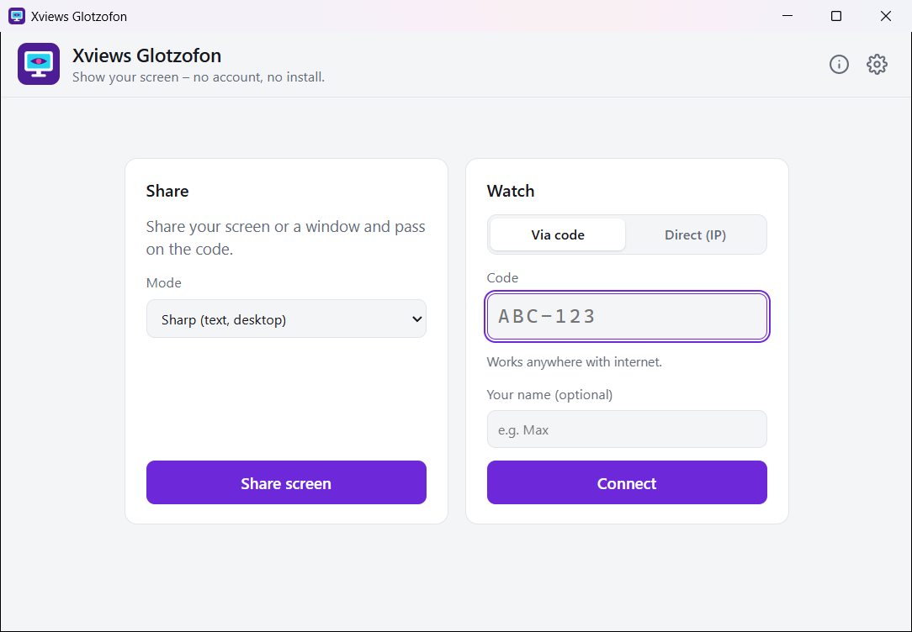
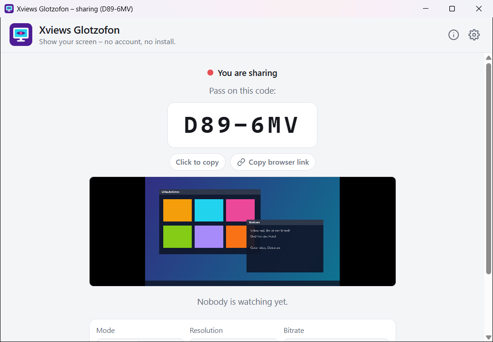
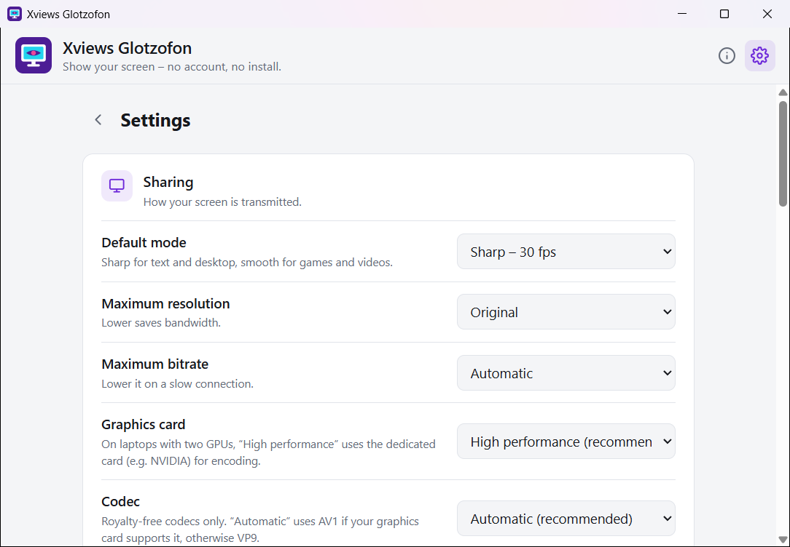

# Xviews Glotzofon

Deutsche Fassung: [README.md](README.md) · Website: [xviews.github.io/xviews-glotzofon](https://xviews.github.io/xviews-glotzofon/)

**Sound familiar?** You just want to show your friends something on your screen, and suddenly everyone has to install a remote desktop tool, create an account or join a call.

**With Xviews Glotzofon it goes like this:** start the EXE, pass on the code, done. Your friends watch in the app or simply in their browser. No installation, no account, no remote control, just watching. A single EXE of about 9 MB, free.

Direct download of the latest version for Windows 10/11 (64-bit), no installation. More notes under [Download](#download).

## Features

- **Share:** your whole screen or a single window, with system audio if you like. The app shows a short code like `K7M-X4P` that you pass on.
  - **Two modes:** *Sharp* (30 fps, resolution first, for text and desktop) and *Smooth* (60 fps, frame rate first, for games and videos).
  - **Several viewers** at the same time.
  - **Royalty-free codecs only:** AV1, VP9 and VP8. If your graphics card can do AV1 (NVIDIA RTX 40/50, Intel Arc, newer AMD), it encodes the picture, otherwise the CPU takes over with VP9. The app shows which encoder is running.
  - **Quick settings:** change mode, resolution and bitrate while sharing, instantly and without reconnecting.
  - **Floating bar:** after you start, the window turns into a slim bar at the edge of the screen with the code, viewers and the most important switches. Without the mouse it folds into a small tab. Viewers can't see it. Alternatively, the window goes to the notification area or stays open.
  - **Graphics card:** on laptops with two graphics chips, Glotzofon uses the high-performance one.
  - **Switch source:** share another monitor or window without a new code.
  - **Fixed code:** optionally always the same code that friends can remember.
- **Watch:** enter the code, connect. Full screen by double-click or F11, sound on/off, resolution, fps and bitrate display.
  - **In the browser too, no app needed:** type the code on the [website](https://xviews.github.io/xviews-glotzofon/) or open the link from the app, e.g. `https://xviews.github.io/xviews-glotzofon/#K7M-X4P`.
  - **Zoom and pan** with mouse wheel and drag, handy for large screens.
  - **Reactions and point ping:** 👍, “Bigger please”, “No sound” … Right-click the picture and a circle appears at exactly that spot on the sharer's screen.
  - **Connection light:** green, yellow or red, with ping and packet loss.
- **English and German**, switchable (follows the Windows language by default).
- **Ways to connect, your choice:**
  - **By code (internet):** works almost everywhere. Both sides find each other through a signaling server (public or your own).
  - **Directly on your own network (IP address):** no server and no internet needed, e.g. at home or at a LAN party.
  - **Relay server (TURN, optional):** for networks where no direct connection can be made.
- **Settings:** mode, maximum resolution and bitrate, graphics card, codec, behavior while sharing, system audio, copy code automatically, fixed code, ways to connect, server, theme (like Windows, light, dark), language.
- **One-click updates:** the app reports new versions, downloads them after asking, verifies the checksum and restarts.

## Download

➡️ **[Latest version under “Releases”](../../releases/latest)**

| File | Size | Note |
|---|---|---|
| `XviewsGlotzofon.exe` | about 9 MB | runs right away, no installation |

**Requirements:** Windows 10 or 11 (64-bit). The app uses Microsoft Edge WebView2, which comes with Windows, no matter which browser you use.

**Security:** the checksum (SHA-256) of every version is in the release notes. You can check it yourself in PowerShell with `Get-FileHash .\XviewsGlotzofon.exe`. Every version is also scanned on VirusTotal, the result is linked in the release notes as well. For version 1.0.0, 3 of 71 scanners report a false positive (smaller vendors using pattern or AI scoring). Microsoft Defender and all major vendors find nothing ([result](https://www.virustotal.com/gui/file/5796ac13a9d63ab1bce1c9ad7010139bd5bcdaed1048462c910596d53c944b94)).

**On first start:**
- If SmartScreen says “Unknown publisher”, click **“More info”** and then **“Run anyway”**. The EXE isn't signed because a certificate costs money.
- If you use the direct connection, Windows Firewall asks once whether Glotzofon may be reachable on the network.
- Settings are stored in your Windows user folder (`%LOCALAPPDATA%\XviewsGlotzofon`). Under **Info** you can switch to portable mode, then everything sits next to the EXE, handy on a USB stick.

## Important

- Viewers see everything that happens on the shared screen or window. Check what you share first, and only give the code to people you know.
- Use at your own risk.
- The tool collects no data and sends nothing to me. It only goes online in these cases:
  - **Signaling server** (public `0.peerjs.com` from the PeerJS project, or your own): only when sharing and watching by code, to set up the connection. The server sees the code and the IP addresses, not the picture.
  - **STUN** (Google, Cloudflare): lets both sides learn their public address.
  - **The picture** travels directly and encrypted (DTLS-SRTP) from PC to PC, unless you set up a relay server yourself.
  - **Update check:** the public release page on GitHub is queried, once a day by default. Selectable in the settings: on every start, once a day, once a week or never.

## About the name

**Glotzofon** is a real word in the German [Duden](https://www.duden.de/rechtschreibung/Glotzofon) dictionary: around 1960 it was a jokey name for the TV, from *glotzen* (to gawk) and *-fon* as in gramophone. Back then the whole family sat in front of the Glotzofon. Today your screen becomes the TV for your friends for a few minutes.

And **Xviews**? It stands for “seeing the unknown”. Here it's whatever is on your screen right now that you just have to show your people.

**Xviews Glotzofon: pass the code, telly on.**

## Report a bug

Bugs and ideas are welcome under **[Issues](../../issues)**, ideally with a screenshot and your Windows version.

## Terms of use

Xviews Glotzofon is **free for private use**. Passing on the unmodified program file is allowed.

Not permitted: selling it, modifying the program, reverse engineering (decompiling, disassembling), taking over program code or parts of it into other software, and feeding the program or its code into AI systems to analyze or rebuild it.

The German [LICENSE.txt](LICENSE.txt) is binding; this is a translation for your convenience.

© 2026 Xviews. The rights to included components (PeerJS, go-webview2, go-winloader, coder/websocket, Go, Microsoft Edge WebView2 SDK) belong to their respective authors. The licenses are listed in the app under **Info**.
