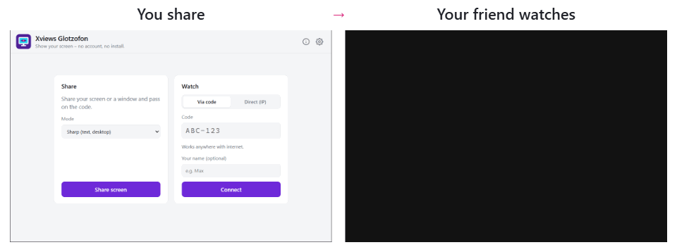

  

<h1 align="center">Xviews Glotzofon</h1>

  <b>Show your screen, no fuss.</b> 
  Screen sharing without an account, without installing, without remote control.

  

  <a href="#how-it-works">How it works</a> ·
  <a href="#features">Features</a> ·
  <a href="#download">Download</a> ·
  <a href="#privacy-and-security">Privacy</a> ·
  <a href="README.md">Deutsch</a>

---

**Sound familiar?** You just want to show your friends something on your screen, and suddenly everyone has to install a remote desktop tool, create an account or join a call.

**With Xviews Glotzofon:** start the EXE, pass on the code, done. Your friends watch in the app, and soon simply in their browser too. A single EXE of about 9 MB, free for Windows 10 and 11.

  <picture>
    <source media="(prefers-color-scheme: dark)" srcset="bilder/en/dark/2-teilen.png">
    
  </picture>

## How it works

| 1️⃣ Start | 2️⃣ Pass the code | 3️⃣ Telly on |
|---|---|---|
| Open `XviewsGlotzofon.exe`, click **Share screen** and pick your whole screen or a window. | Glotzofon shows a code like `K7M-X4P` and copies it right away. Send it via messenger. | Your friends type the code into their Glotzofon app and watch. |

  <picture>
    <source media="(prefers-color-scheme: dark)" srcset="bilder/demo-dark-en.gif">
    
  </picture> 
  You share on the left, Max watches on the right. His right-click on the picture shows up as a circle on your side.

## Features

**Sharing**
- 🖥️ **Whole screen or one window**, with system audio if you like.
- 🎚️ **Two modes:** *Sharp* (30 fps, for text and desktop) and *Smooth* (60 fps, for games and videos).
- 📌 **Floating bar:** once you start, the window turns into a slim bar at the edge of the screen with the code, viewers and quick settings. Without the mouse it folds into a small tab. Viewers don't see it.
- ⚡ **Quick settings:** change fps, resolution and bitrate live, without reconnecting.
- 🔀 **Switch source:** share another monitor or window without a new code.
- 👥 **Several viewers** at once, optionally with a **fixed code** your friends can remember.
- 🎮 **GPU encoding:** royalty-free codecs only. AV1 on the graphics card (NVIDIA RTX 40/50, Intel Arc, newer AMD), otherwise VP9 on the CPU. Laptops with two graphics chips use the high-performance one.

**Watching**
- 📺 **Full screen** by double-click or F11, sound on/off.
- 🔍 **Zoom and pan** with mouse wheel and drag.
- 👍 **Reactions and point ping:** 👍, “Bigger please”, “No sound” … Right-click the picture and a circle appears at exactly that spot on the sharer's screen.
- 🚦 **Connection light** with ping and packet loss.
- 🌐 **Watching in the browser without the app: coming soon.** Until then everyone watches in the app. That's why the “Copy browser link” button doesn't work yet.

**Also**
- 🔗 **Ways to connect, your choice:** by code over the internet, directly by IP address on your own network (no server at all, also at a LAN party), with your own signaling server or a relay server (TURN).
- ⚙️ **Settings:** mode, resolution, bitrate, graphics card, codec, bar/notification area/window while sharing, system audio, fixed code, server, light/dark/like Windows.
- 🌍 **English and German**, follows the Windows language.
- 🔄 **One-click updates** with checksum verification.

<table>
  <tr>
    <td width="50%"><picture><source media="(prefers-color-scheme: dark)" srcset="bilder/en/dark/1-start.png"></picture></td>
    <td width="50%"><picture><source media="(prefers-color-scheme: dark)" srcset="bilder/en/dark/3-einstellungen.png"></picture></td>
  </tr>
  <tr>
    <td align="center">Home screen</td>
    <td align="center">Settings</td>
  </tr>
</table>

## Download

| File | Size | Note |
|---|---|---|
| [`XviewsGlotzofon.exe`](https://github.com/xviews/xviews-glotzofon/releases/latest/download/XviewsGlotzofon.exe) | about 9 MB | Windows 10/11 (64-bit), runs right away, no installation |

➡️ All versions and checksums under **[Releases](../../releases)**.

<b>On first start</b>

- If SmartScreen says “Unknown publisher”, click **“More info”** and then **“Run anyway”**. The EXE isn't signed because a certificate costs money.
- If you use the direct connection, Windows Firewall asks once whether Glotzofon may be reachable on the network.
- The app uses Microsoft Edge WebView2, which comes with Windows, no matter which browser you use.
- Settings are stored in your Windows user folder (`%LOCALAPPDATA%\XviewsGlotzofon`). Under **Info** you can switch to portable mode, then everything sits next to the EXE, handy on a USB stick.

## Privacy and security

- 🙈 **Viewers see everything** that happens on the shared screen or window. Check what you share first, and only give the code to people you know.
- 🔒 **The picture travels directly and encrypted** (DTLS-SRTP) from PC to PC, not through a server of mine.
- 🚫 **No accounts, no data collection.** The app sends nothing to me.
- 🛡️ **Verified:** the checksum (SHA-256) of every version is in the release notes, check it yourself with `Get-FileHash .\XviewsGlotzofon.exe`. On VirusTotal, Microsoft Defender and all major vendors find nothing, 3 smaller ones out of 71 scanners report a false positive ([result for 1.0.0](https://www.virustotal.com/gui/file/5796ac13a9d63ab1bce1c9ad7010139bd5bcdaed1048462c910596d53c944b94)).

<b>When the app goes online</b>

- **Signaling server** (public `0.peerjs.com` from the PeerJS project, or your own): only when sharing and watching by code, to set up the connection. The server sees the code and the IP addresses, not the picture.
- **STUN** (Google, Cloudflare): lets both sides learn their public address.
- **Relay server (TURN):** only if you enter one yourself. The picture then travels encrypted through that server.
- **Update check:** the public release page on GitHub is queried, once a day by default. Selectable in the settings: on every start, daily, weekly or never.
- With the **direct connection on your own network**, nothing goes to the internet.

Use at your own risk.

## About the name

**Glotzofon** is a real word in the German [Duden](https://www.duden.de/rechtschreibung/Glotzofon) dictionary: around 1960 it was a jokey name for the TV, from *glotzen* (to gawk) and *-fon* as in gramophone. Back then the whole family sat in front of the Glotzofon. Today your screen becomes the TV for your friends for a few minutes.

And **Xviews**? It stands for “seeing the unknown”. Here it's whatever is on your screen right now that you just have to show your people.

<b>Xviews Glotzofon: pass the code, telly on.</b>

## Report a bug

Bugs and ideas are welcome under **[Issues](../../issues/new/choose)**, ideally with a screenshot and your Windows version.

## Terms of use

Xviews Glotzofon is **free for private use**. Passing on the unmodified program file is allowed.

What is not allowed, and rights to components

Not permitted: selling it, modifying the program, reverse engineering (decompiling, disassembling), taking over program code or parts of it into other software, and feeding the program or its code into AI systems to analyze or rebuild it. The German [LICENSE.txt](LICENSE.txt) is binding; this is a translation for your convenience.

© 2026 Xviews. The rights to included components (PeerJS, go-webview2, go-winloader, coder/websocket, Go, Microsoft Edge WebView2 SDK) belong to their respective authors. The licenses are listed in the app under **Info**.

