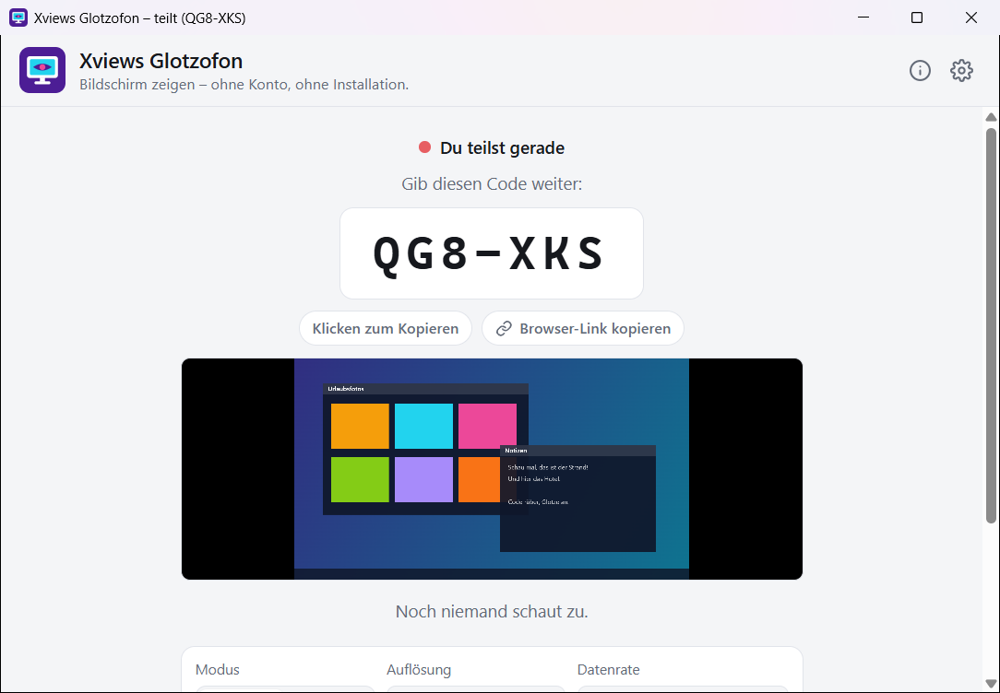
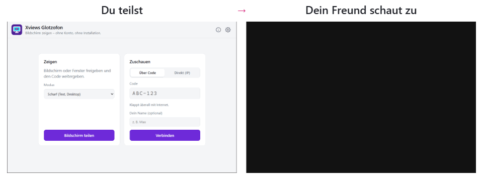
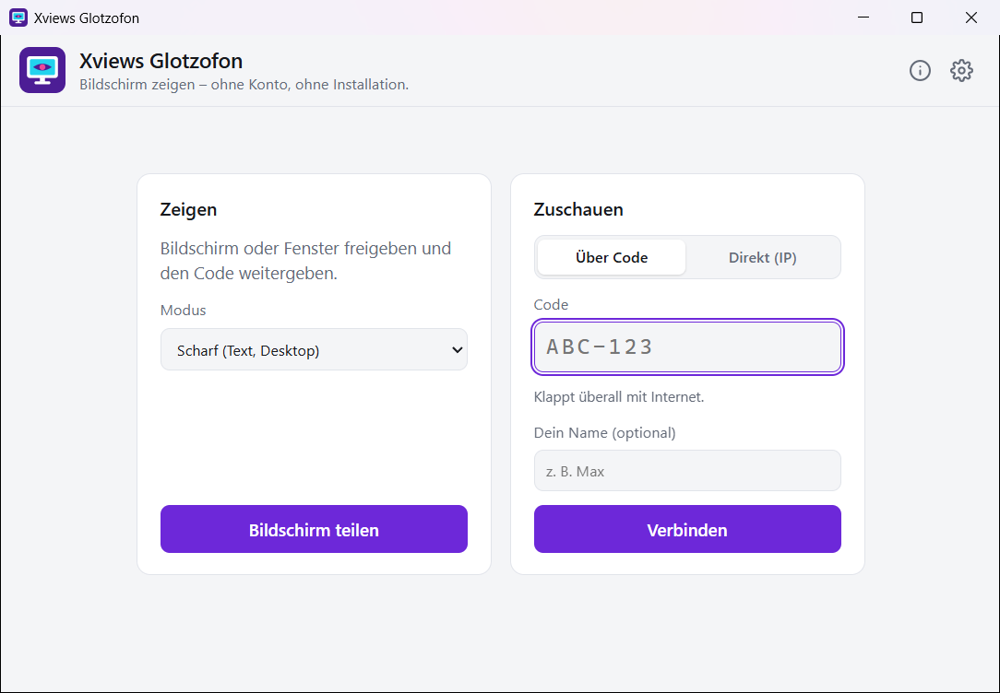
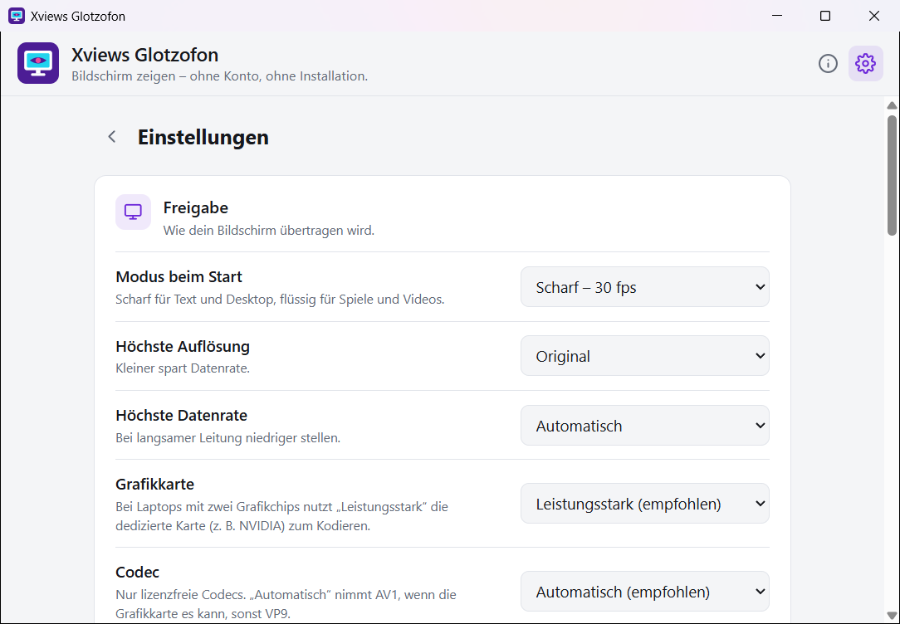

  

<h1 align="center">Xviews Glotzofon</h1>

  <b>Kurz was zeigen, ohne Gedöns.</b> 
  Bildschirm teilen ohne Konto, ohne Installation, ohne Fernsteuerung.

  

  <a href="#so-gehts">So geht's</a> ·
  <a href="#funktionen">Funktionen</a> ·
  <a href="#download">Download</a> ·
  <a href="#datenschutz-und-sicherheit">Datenschutz</a> ·
  <a href="README.en.md">English</a>

---

**Nervt es dich auch?** Du willst deinen Freunden nur kurz etwas auf deinem Bildschirm zeigen, und plötzlich muss jeder erst ein Fernwartungsprogramm installieren, ein Konto anlegen oder in einen Call einsteigen.

**Mit Xviews Glotzofon:** EXE starten, Code weitergeben, fertig. Deine Freunde schauen in der App zu, bald auch einfach im Browser. Eine einzige EXE mit rund 9 MB, kostenlos für Windows 10 und 11.

  <picture>
    <source media="(prefers-color-scheme: dark)" srcset="bilder/dark/2-teilen.png">
    
  </picture>

## So geht's

| 1️⃣ Starten | 2️⃣ Code rüber | 3️⃣ Glotze an |
|---|---|---|
| `XviewsGlotzofon.exe` öffnen, auf **Bildschirm teilen** klicken und den ganzen Bildschirm oder ein Fenster wählen. | Glotzofon zeigt einen Code wie `K7M-X4P` und kopiert ihn gleich. Per Messenger weitergeben. | Deine Freunde tippen den Code in ihre Glotzofon-App ein und schauen zu. |

  <picture>
    <source media="(prefers-color-scheme: dark)" srcset="bilder/demo-dark-de.gif">
    
  </picture> 
  Links teilst du, rechts schaut Max zu. Sein Rechtsklick ins Bild erscheint bei dir als Kreis.

## Funktionen

**Zeigen**
- 🖥️ **Ganzer Bildschirm oder ein Fenster**, auf Wunsch mit Systemton.
- 🎚️ **Zwei Modi:** *Scharf* (30 fps, für Text und Desktop) und *Flüssig* (60 fps, für Spiele und Videos).
- 📌 **Schwebende Leiste:** Nach dem Start wird das Fenster zu einer schmalen Leiste am Bildschirmrand, mit Code, Zuschauern und Schnellauswahl. Ohne Maus klappt sie zum kleinen Reiter zusammen. Zuschauer sehen sie nicht.
- ⚡ **Schnellauswahl:** fps, Auflösung und Datenrate live umstellen, ohne neue Verbindung.
- 🔀 **Quelle wechseln:** anderen Monitor oder anderes Fenster teilen, ohne neuen Code.
- 👥 **Mehrere Zuschauer** gleichzeitig, auf Wunsch mit **festem Code**, den sich Freunde merken können.
- 🎮 **Grafikkarte kodiert:** nur lizenzfreie Codecs. AV1 per Grafikkarte (NVIDIA RTX 40/50, Intel Arc, neuere AMD), sonst VP9 auf der CPU. Laptops mit zwei Grafikchips nutzen die leistungsstarke Karte.

**Zuschauen**
- 📺 **Vollbild** per Doppelklick oder F11, Ton an/aus.
- 🔍 **Zoom und Verschieben** mit Mausrad und Ziehen.
- 👍 **Reaktionen und Zeigen-Ping:** 👍, „Größer bitte“, „Ton fehlt“ … Ein Rechtsklick ins Bild zeigt beim Teilenden genau an der Stelle einen Kreis.
- 🚦 **Verbindungsampel** mit Ping und Paketverlust.
- 🌐 **Zuschauen im Browser ohne App: kommt bald.** Bis dahin schauen alle in der App zu. Der Knopf „Browser-Link kopieren“ funktioniert deshalb gerade noch nicht.

**Außerdem**
- 🔗 **Verbindungswege zum Auswählen:** über Code im Internet, direkt per IP-Adresse im eigenen Netz (ganz ohne Server, auch auf der LAN-Party), mit eigenem Vermittlungsserver oder Relay-Server (TURN).
- ⚙️ **Einstellungen:** Modus, Auflösung, Datenrate, Grafikkarte, Codec, Leiste/Infobereich/Fenster beim Teilen, Systemton, fester Code, Server, Hell/Dunkel/wie Windows.
- 🌍 **Deutsch und Englisch**, folgt der Windows-Sprache.
- 🔄 **Updates mit einem Klick**, mit Prüfsummen-Check.

<table>
  <tr>
    <td width="50%"><picture><source media="(prefers-color-scheme: dark)" srcset="bilder/dark/1-start.png"></picture></td>
    <td width="50%"><picture><source media="(prefers-color-scheme: dark)" srcset="bilder/dark/3-einstellungen.png"></picture></td>
  </tr>
  <tr>
    <td align="center">Startseite</td>
    <td align="center">Einstellungen</td>
  </tr>
</table>

## Download

| Datei | Größe | Hinweis |
|---|---|---|
| [`XviewsGlotzofon.exe`](https://github.com/xviews/xviews-glotzofon/releases/latest/download/XviewsGlotzofon.exe) | ca. 9 MB | Windows 10/11 (64 Bit), läuft sofort, keine Installation |

➡️ Alle Versionen und Prüfsummen unter **[Releases](../../releases)**.

<b>Beim ersten Start</b>

- Meldet SmartScreen „Unbekannter Herausgeber“, auf **„Weitere Informationen“** und dann auf **„Trotzdem ausführen“** klicken. Die EXE ist nicht signiert, weil ein Zertifikat Geld kostet.
- Nutzt du die Direktverbindung, fragt die Windows-Firewall einmal nach, ob Glotzofon im Netzwerk erreichbar sein darf.
- Die App nutzt Microsoft Edge WebView2, das bei Windows dabei ist, egal welchen Browser du verwendest.
- Einstellungen liegen in deinem Windows-Benutzerordner (`%LOCALAPPDATA%\XviewsGlotzofon`). Unter **Info** lässt sich auf den portablen Modus umstellen, dann liegt alles neben der EXE, praktisch auf einem USB-Stick.

## Datenschutz und Sicherheit

- 🙈 **Wer zuschaut, sieht alles**, was im freigegebenen Bildschirm oder Fenster passiert. Vorher prüfen, was geteilt wird, und den Code nur Leuten geben, die du kennst.
- 🔒 **Das Bild läuft direkt und verschlüsselt** (DTLS-SRTP) von PC zu PC, nicht über einen Server von mir.
- 🚫 **Keine Konten, keine Datensammlung.** Die App schickt nichts an mich.
- 🛡️ **Geprüft:** Die Prüfsumme (SHA-256) jeder Version steht im Release-Text, selbst prüfen mit `Get-FileHash .\XviewsGlotzofon.exe`. Bei VirusTotal finden Microsoft Defender und alle großen Hersteller nichts, 3 kleinere von 71 Scannern melden einen Fehlalarm ([Ergebnis für 1.0.0](https://www.virustotal.com/gui/file/5796ac13a9d63ab1bce1c9ad7010139bd5bcdaed1048462c910596d53c944b94)).

<b>Wann die App ins Internet geht</b>

- **Vermittlungsserver** (öffentlich `0.peerjs.com` vom PeerJS-Projekt, oder dein eigener): nur beim Teilen und Zuschauen über Code, um die Verbindung aufzubauen. Der Server sieht den Code und die IP-Adressen, nicht das Bild.
- **STUN** (Google, Cloudflare): Damit erfahren beide Seiten ihre öffentliche Adresse.
- **Relay-Server (TURN):** nur, wenn du selbst einen einträgst. Dann läuft das Bild verschlüsselt über diesen Server.
- **Update-Suche:** Die öffentliche Release-Seite auf GitHub wird abgefragt, standardmäßig einmal am Tag. In den Einstellungen wählbar: bei jedem Start, täglich, wöchentlich oder nie.
- Bei der **Direktverbindung im eigenen Netz** geht nichts ins Internet.

Nutzung auf eigene Verantwortung.

## Über den Namen

**Glotzofon** steht wirklich im [Duden](https://www.duden.de/rechtschreibung/Glotzofon): So nannte man um 1960 scherzhaft den Fernseher, aus *glotzen* und *-fon* wie beim Grammofon. Damals saß die ganze Familie vor dem Glotzofon. Heute ist es dein Bildschirm, der für ein paar Minuten zum Fernseher für deine Freunde wird.

Und **Xviews**? Das steht für „das Unbekannte sehen“. Hier ist es das, was du gerade auf dem Bildschirm hast und deinen Leuten unbedingt zeigen willst.

<b>Xviews Glotzofon: Code rüber, Glotze an.</b>

## Fehler melden

Fehler und Ideen gerne unter **[Issues](../../issues/new/choose)**, am besten mit Screenshot und Windows-Version.

## Nutzungsbedingungen

Xviews Glotzofon ist **kostenlos für die private Nutzung**. Die unveränderte Weitergabe der Programmdatei ist erlaubt.

Was nicht erlaubt ist, und Rechte an Komponenten

Nicht gestattet sind: der Verkauf, das Verändern des Programms, das Zurückentwickeln (Dekompilieren, Disassemblieren), die Übernahme von Programmcode oder Teilen davon in andere Software sowie das Einspeisen des Programms oder seines Codes in KI-Systeme, um es zu analysieren oder nachzubauen. Verbindlich ist die [LICENSE.txt](LICENSE.txt).

© 2026 Xviews. Die Rechte an eingebundenen Komponenten (PeerJS, go-webview2, go-winloader, coder/websocket, Go, Microsoft Edge WebView2 SDK) liegen bei ihren jeweiligen Urhebern. Die Lizenzen stehen in der App unter **Info**.

